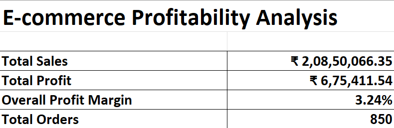
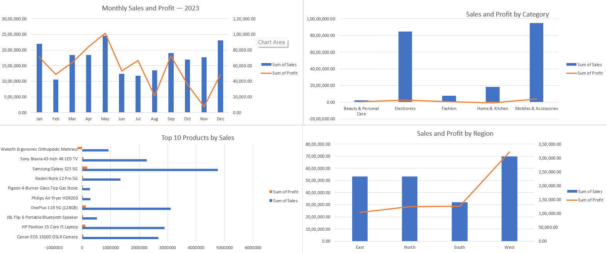
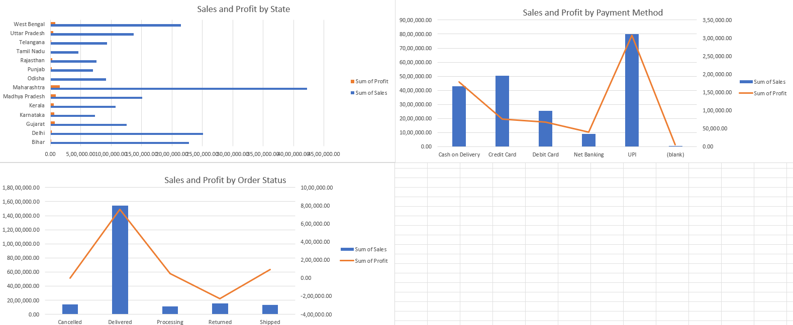

# E-commerce Profitability Analysis

## Project Overview

This project analyzes e-commerce sales and profitability using Excel and PostgreSQL. It explores sales trends, product performance, category profitability, regional performance, payment methods, and order statuses to identify business opportunities and loss-making areas.

## Business Problem

High sales do not always translate into high profits. Businesses need to understand which products and categories are profitable, where sales are performing well, and how returns affect overall profitability.

This project uses sales data to investigate these questions and provide data-driven recommendations.

## Project Objectives

- Analyze monthly sales and profit trends.
- Identify top-performing and loss-making products.
- Compare sales and profitability across categories and regions.
- Examine state-level performance and payment methods.
- Evaluate order statuses and losses associated with returned orders.
- Build an Excel dashboard to communicate the findings.

## Tools Used

- **Microsoft Excel:** Data exploration, PivotTables, charts, KPI summary, and dashboard creation.
- **PostgreSQL:** SQL queries, aggregations, profitability calculations, and business analysis.
- **Git and GitHub:** Version control, project documentation, and portfolio publishing.

## 📊 Dashboard Preview

View the Excel dashboard screenshots below.


### Dashboard Overview


### Sales Analysis


### Detailed Analysis



## 🔍 Key Business Findings

The analysis of 850 e-commerce order records revealed the following:

- **Overall performance:** Total sales were ₹2,08,50,066.35, with a total profit of ₹6,75,411.54 and an overall profit margin of 3.24%.
- **Top sales category:** Mobiles & Accessories generated ₹95,06,179.75 in sales and ₹3,71,787.15 in profit.
- **Loss-making category:** Home & Kitchen recorded a loss of ₹67,894.62, with a negative profit margin of 3.67%.
- **Regional performance:** The West region generated the highest sales at ₹69,78,072.60 and the highest profit at ₹3,20,958.13.
- **Product profitability:** The Wakefit mattress generated ₹9,17,426.60 in sales but recorded a loss of ₹1,58,120.48.
- **Returns:** Returned orders recorded a total loss of ₹2,28,411.77.

### Business Recommendations

- Investigate costs, pricing, and discounts in the Home & Kitchen category.
- Review the profitability of high-sales products that are generating losses.
- Analyze return reasons and product-level return rates to reduce losses.
- Study the West region's performance to identify practices that may be useful in other regions.
- Track profit margin alongside sales instead of judging performance by sales alone.


## Dataset

The project uses an e-commerce sales dataset containing 850 records after duplicate Order IDs were removed during data cleaning.

The dataset was used to analyze sales, profit, product categories, regions, states, payment methods, and order statuses.

## 🔎 SQL Analysis

The PostgreSQL analysis covers:

1. Monthly sales, profit, and order trends.
2. Sales and profit by product category.
3. Top-selling products and their profitability.
4. Regional sales and profit comparisons.
5. State-level sales and profit margins.
6. Sales and profitability by payment method.
7. Performance by order status.
8. Products associated with losses from returned orders.
9. Overall sales, profit, profit margin, and order counts.

The SQL queries are available in `ecommerce_profitability_analysis.sql`.

## Project Structure

```text
ecommerce-profitability-analysis/
├── README.md
├── data/
│   ├── raw/
│   └── cleaned/
├── excel/
│   ├── ecommerce_profitability_analysis.xlsx
│   └── ecommerce_sales_working.xlsx
├── images/
│   ├── dashboard-overview.png
│   ├── sales-analysis.png
│   └── detailed-analysis.png
└── sql/
    └── ecommerce_profitability_analysis.sql
```

## How to Explore the Project

1. View the dashboard screenshots in the README.
2. Open the Excel workbook in the `excel/` folder to explore the dashboard and analysis sheets.
3. Open the SQL file in the `sql/` folder to review the PostgreSQL queries.
4. Explore the cleaned CSV in `data/cleaned/` to understand the dataset.

##  Future Improvements

- Build an interactive dashboard in Power BI.
- Add more detailed analysis of return reasons and product profitability.
- Improve the analysis with additional business metrics as needed.
